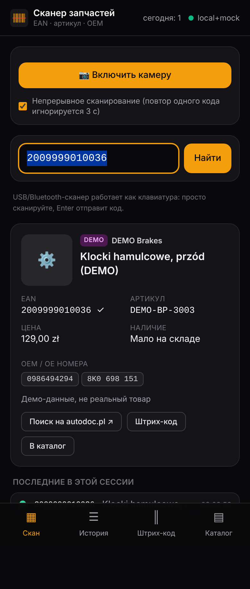
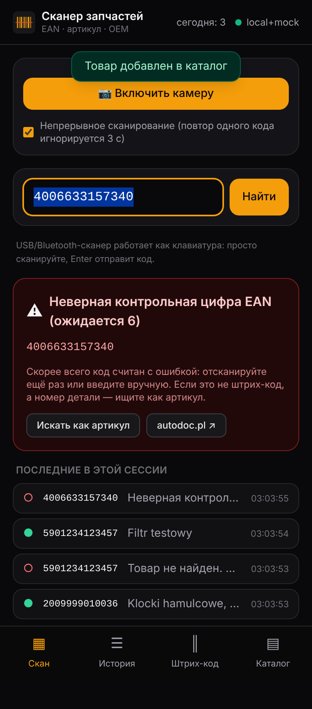
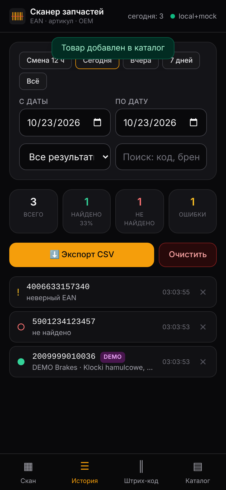
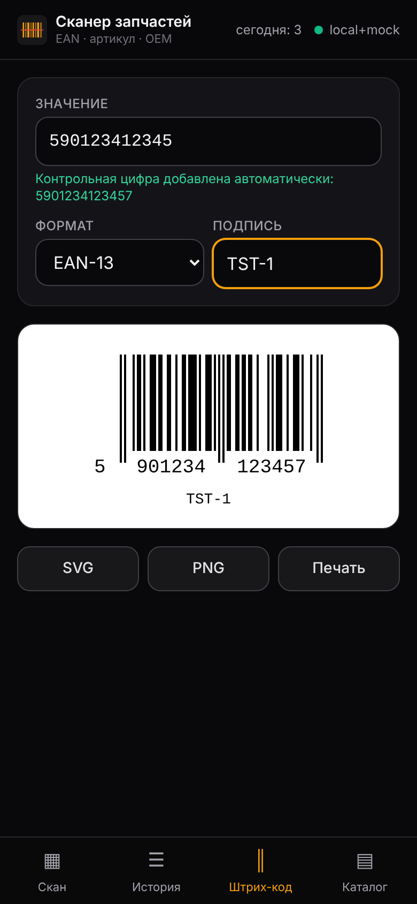

# autodoc-barcode-scanner

Быстрый веб-сканер штрих-кодов (EAN/GTIN) и артикулов автозапчастей для склада: камера телефона или USB/Bluetooth-сканер → карточка товара → история смены → экспорт в CSV/Excel. Поддерживается генерация EAN-13/EAN-8/Code128 для печати и проверки.

**Основной путь работы — без интернета:** `скан → проверка EAN → локальный каталог (SQLite)`. Если товара нет, есть ссылка «Искать на autodoc.pl» и ручное добавление в каталог. Автоматический запрос к autodoc.pl — **опциональный** провайдер, по умолчанию выключен (см. [docs/AUTODOC.md](docs/AUTODOC.md)).

```
┌──────────┐  код   ┌────────────────── backend (Express) ──────────────────┐
│ камера / │ ─────► │ 1. проверка EAN (контрольная цифра) / нормализация    │
│ сканер / │        │ 2. локальный каталог SQLite  ◄── ручной ввод, импорт │
│ ввод     │ ◄───── │ 3. [опц.] autodoc | scraper API | mock               │
└──────────┘ товар  │    кэш · 1 запрос/3 с · дневной лимит · пауза на 403 │
                    │ 4. запись в историю сканов (без персональных данных) │
                    └───────────────────────────────────────────────────────┘
```

<p>




</p>

## Возможности

| | |
|---|---|
| **Сканирование** | Камера (html5-qrcode, нативный `BarcodeDetector` на Android/Chrome), фонарик, смена камеры, непрерывный режим с подавлением повторов. Аппаратные сканеры в режиме клавиатуры работают без настройки. Звук и вибрация при успехе или ошибке. |
| **Поиск** | По EAN-8/12/13/14 (UPC-A приводится к EAN-13), артикулу (`0 986-494.294` = `0986494294`) и OEM-номерам. Несколько совпадений показываются списком. |
| **Карточка** | Название, бренд, EAN с отметкой ✓/✗, артикул, OEM, цена, наличие, фото, ссылка на autodoc.pl, источник данных (каталог / autodoc / DEMO). |
| **Ошибки** | Неверная контрольная цифра (с подсказкой ожидаемой), «не найдено» с ручным добавлением, лимит запросов, блокировка источника, офлайн. |
| **Штрих-коды** | EAN-13 (контрольная цифра дописывается сама), EAN-8, Code128. Подпись, скачивание SVG/PNG, печать. |
| **История** | Фильтры: смена 12 ч / сегодня / вчера / 7 дней / даты, найдено / не найдено / ошибки, поиск. Мини-KPI. CSV для Excel (`;`, UTF-8 BOM, десятичная запятая). Автоочистка через N дней. |
| **Каталог** | Ручное добавление и редактирование, импорт и экспорт CSV (заголовки EN/PL/RU). |
| **Интерфейс** | Тёмный, mobile-first, устанавливается как PWA. Работает без CDN: все библиотеки отдаёт сервер. |

## Структура

```
.
├── backend/
│   ├── src/
│   │   ├── server.js            # запуск, housekeeping (очистка истории/кэша)
│   │   ├── app.js               # Express: API + статика + vendor-библиотеки
│   │   ├── config.js            # все настройки из env / .env
│   │   ├── middleware.js        # CSP/заголовки, Basic auth, rate limit, ошибки
│   │   ├── db/schema.sql        # таблицы products, scans, lookup_cache
│   │   ├── db/index.js          # репозиторий (весь SQL здесь → легко на PostgreSQL)
│   │   ├── lib/ean.js           # GTIN/EAN: контрольная цифра, классификация (общий с браузером)
│   │   ├── lib/throttle.js      # очередь исходящих запросов, лимиты, circuit breaker
│   │   ├── lib/csv.js           # CSV (Excel-friendly, защита от formula injection)
│   │   ├── providers/
│   │   │   ├── autodoc.js         # поиск → карточка товара на autodoc.pl
│   │   │   ├── autodoc-parser.js  # JSON-LD → microdata → OpenGraph → подписи на PL
│   │   │   ├── robots.js          # соблюдение robots.txt
│   │   │   ├── scraper.js         # ScraperAPI / ZenRows / Piloterr / custom
│   │   │   └── mock.js            # демо-данные
│   │   ├── services/            # lookup pipeline, валидация/импорт товаров
│   │   └── routes/              # /api/lookup, /api/scans, /api/products
│   ├── scripts/import-csv.js    # импорт каталога из CSV
│   ├── scripts/probe-autodoc.js # безопасная разовая проверка autodoc.pl
│   ├── data/mock-products.json  # 10 демо-товаров (EAN 2009999010012…)
│   └── test/                    # node:test — 23 теста, сеть не нужна
├── frontend/
│   ├── index.html               # SPA: Скан · История · Штрих-код · Каталог
│   ├── js/                      # vanilla ES-модули
│   └── css/tailwind.css         # собранный Tailwind (исходник tailwind.src.css)
├── docs/                        # AUTODOC.md, DEPLOY.md, POSTGRES.md, API.md, sample-products.csv
├── Dockerfile · railway.json · render.yaml · .env.example
```

## Быстрый старт

Нужен **Node.js 22.13+** (используется встроенный `node:sqlite`, нативные модули не нужны).

```bash
git clone <repo-url> autodoc-barcode-scanner && cd autodoc-barcode-scanner
cp .env.example .env          # по умолчанию: локальный каталог + DEMO-данные
npm install                   # ставит зависимости backend
npm start                     # http://localhost:3000
```

Попробуйте: `2009999010012` (демо-EAN), `0986494294` (OEM из демо), `5901234123458` (неверная контрольная цифра).

```bash
npm test                      # 23 теста (EAN, парсер autodoc, API, лимиты, robots.txt)
npm run dev                   # перезапуск при изменениях
npm run import -- docs/sample-products.csv   # импорт каталога
npm run build:css             # пересобрать Tailwind после правки классов в HTML/JS
```

Docker:

```bash
docker build -t barcode-scanner .
docker run -p 3000:3000 -v scanner-data:/data --env-file .env barcode-scanner
```

### Камера на телефоне

Браузер даёт доступ к камере только по **HTTPS** или на `localhost`. Варианты:

- задеплоить (Railway/Render выдают HTTPS автоматически) — см. [docs/DEPLOY.md](docs/DEPLOY.md);
- в локальной сети — туннель: `npx cloudflared tunnel --url http://localhost:3000` или `ngrok http 3000`;
- ручной ввод и USB-сканер работают и по HTTP.

Если инстанс доступен из интернета, задайте `BASIC_AUTH_USER` / `BASIC_AUTH_PASS`.

## Источники данных

Порядок задаётся в `EXTERNAL_PROVIDERS`; локальный каталог проверяется всегда и первым.

| Значение | Что делает | Когда использовать |
|---|---|---|
| *(пусто)* | Только локальный каталог | **Продакшн по умолчанию.** Каталог наполняется импортом CSV (например, выгрузкой WMS) и ручным добавлением. |
| `mock` | Демо-товары с EAN 200… (зона GS1 для внутреннего использования, с реальными товарами не пересекаются) | Разработка и демонстрация UI. |
| `autodoc` | 1–2 вежливых запроса к autodoc.pl: поиск → карточка, с соблюдением robots.txt | Только если есть разрешение или вы приняли риски, см. [docs/AUTODOC.md](docs/AUTODOC.md). |
| `scraper` | То же через scraping-API | Когда прямой доступ блокируется и использование согласовано. |

Найденное во внешнем источнике **сохраняется в локальный каталог**, поэтому повторный скан того же кода не уходит в сеть. Mock-данные в каталог не сохраняются.

### Как подключить scraper API (ключ)

```env
EXTERNAL_PROVIDERS=scraper
SCRAPER_PROVIDER=scraperapi        # scraperapi | zenrows | piloterr | custom
SCRAPER_API_KEY=ваш_ключ
```

- **ScraperAPI** / **ZenRows** / **Piloterr**: пресеты в `backend/src/providers/scraper.js` (у Piloterr ключ передаётся в заголовке `x-api-key`).
- **Любой другой сервис**, который отдаёт HTML по GET:
  `SCRAPER_PROVIDER=custom`, `SCRAPER_URL_TEMPLATE=https://api.example.com/fetch?token={key}&url={url}`.
- **Apify**: акторы запускаются POST-запросом и возвращают dataset, а не HTML. Добавьте пресет в `PRESETS` (`scraper.js`): функция получает URL страницы и должна вернуть HTML. Либо используйте актор с GET-эндпоинтом, отдающим HTML, через `custom`.

Ключ хранится только в env/секретах платформы, в коде и в репозитории его нет. Перед включением проверьте на одном коде: `npm run probe -- <EAN> --follow --via=scraper`.

## Ограничения и риски

- **ToS autodoc.pl.** Автоматический сбор данных может нарушать условия использования сайта, и сайт может блокировать такие запросы. Поэтому внешний поиск выключен по умолчанию, соблюдает robots.txt, ограничен по частоте и объёму и встаёт на паузу при первом 403/429/капче. Scraping-API меняет только отправителя запроса, но не снимает вопрос ToS. Для служебного использования внутри AutoDoc правильнее запросить у IT доступ к внутреннему API или выгрузке каталога и импортировать её в CSV.
- **Парсер написан по публичной структуре страниц** (URL `/<бренд>/<id>`, «Numer artykułu», «Numer EAN», блок OE-номеров, schema.org), но не проверялся на живом сайте: из среды разработки autodoc.pl был недоступен. Перед использованием выполните `npm run probe` (см. ниже). При смене разметки парсер нужно обновить по сохранённому HTML.
- Совпадение по артикулу может быть неточным: у разных брендов бывают одинаковые номера. В карточке это отмечено бейджем «похоже».
- Цены и наличие во внешних источниках меняются. Кэш хранит их 7 дней; кнопка «Обновить ↻» перезапрашивает данные.
- SQLite рассчитан на один инстанс. Для нескольких реплик нужен PostgreSQL, см. [docs/POSTGRES.md](docs/POSTGRES.md).
- `node:sqlite` в Node 22 помечен как experimental: API стабилен, предупреждение подавлено флагом.

## Персональные данные

Не хранятся: нет пользователей, имён сотрудников, ID устройств и IP в БД и логах. IP держится в памяти только для rate limit в течение минуты. История содержит только код, результат и снимок данных товара и удаляется через `HISTORY_RETENTION_DAYS`.

## Как безопасно протестировать поиск по реальному EAN

Подробно — в [docs/AUTODOC.md](docs/AUTODOC.md). Коротко:

1. Сначала откройте `https://www.autodoc.pl/search?keyword=<EAN>` **вручную в браузере** и убедитесь, что товар находится.
2. В `.env` укажите честный `AUTODOC_USER_AGENT` со своим контактом.
3. Одна проверка, максимум 3 запроса с паузой 5 с, HTML сохраняется в `data/probe/`:
   ```bash
   npm run probe -- 4006633157346            # robots.txt + страница поиска
   npm run probe -- 4006633157346 --follow   # + первая карточка товара
   ```
4. Если `/search` запрещён в robots.txt, скрипт остановится. Это ожидаемо: используйте ручную ссылку и локальный каталог.
5. Если пришли 403/429/капча, не повторяйте запрос. Сайт против автоматического доступа.
6. Только если всё работает и использование согласовано: `EXTERNAL_PROVIDERS=autodoc`, низкий `EXTERNAL_DAILY_LIMIT`, следить за `/api/health`.

## API

Кратко (полностью — [docs/API.md](docs/API.md)):

```
GET    /api/lookup?code=…&type=auto|ean|article&refresh=1&log=0
GET    /api/scans?from=ISO&to=ISO&found=1|0&type=invalid&q=…&limit&offset
GET    /api/scans/export.csv?…&tz=Europe/Warsaw&sep=comma
GET    /api/stats?from&to
DELETE /api/scans/:id      DELETE /api/scans?confirm=1&…
GET    /api/products?q=…   POST /api/products   PUT/DELETE /api/products/:id
POST   /api/products/import  (text/csv)        GET /api/products/export.csv
GET    /api/health
```

## Дальше

Telegram-бот (тот же `LookupService`, `/scan <код>`, фото штрих-кода), KPI по сменам и сотрудникам (только при добавлении учёта сотрудников, с политикой хранения данных), офлайн-режим через Service Worker с очередью сканов, печать этикеток на Zebra (ZPL), PostgreSQL.
